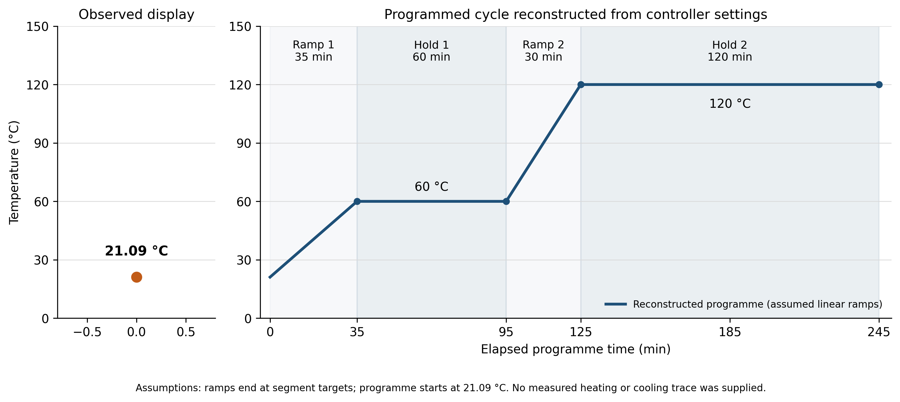

# Practical 4 — Oven temperature plot

Python code for plotting the reconstructed oven programme and the available pre-start temperature observation for the MECH2460 composites practical.



## Run the Python code

Use Python 3.9 or later:

```bash
python3 -m pip install -r requirements.txt
python3 plot_oven_temperature.py
```

The script saves `oven_temperature.png`, `oven_temperature.pdf`, `oven_temperature.svg` and `oven_programme.csv` to `report_assets/` by default.

Choose a different output folder:

```bash
python3 plot_oven_temperature.py --output-dir output
```

## Programme and evidence

| Segment | Duration (min) | End time (min) | Target (°C) | Interpretation |
| --- | ---: | ---: | ---: | --- |
| 1 | 35 | 35 | 60 | Assumed linear ramp |
| 2 | 60 | 95 | 60 | Hold |
| 3 | 30 | 125 | 120 | Assumed linear ramp |
| 4 | 120 | 245 | 120 | Hold |

The programme lasts **245 minutes**. The plot reconstructs the programme from controller settings; linear ramps and a starting programme temperature of **21.09 °C** are assumptions. The only available observed reading is **21.09 °C** on the controller before the programme started. The exact start time was not recorded, so this observation is plotted separately from the programme time axis. No measured heating or cooling history is included, and the figure is not a specimen-temperature or degree-of-cure measurement.

## Optional measured readings

To add real measurements, provide a CSV containing the header `time_min,temperature_C` and one row per reading. Times must be in minutes from a verified programme start; temperatures must be in degrees Celsius. Use finite values and nonnegative times.

```bash
python3 plot_oven_temperature.py --measured measured_temperature.csv
```

Measured readings are plotted as markers without interpolating missing values. The supplied `oven_programme.csv` contains programme metadata and must not be used as a measured-temperature CSV.

## Files

- [Python source](plot_oven_temperature.py)
- [Dependencies](requirements.txt)
- [PNG figure](oven_temperature.png)
- [PDF figure](oven_temperature.pdf)
- [SVG figure](oven_temperature.svg)
- [Programme CSV](oven_programme.csv)

`index.html` provides a static preview and download page for GitHub Pages. Run the Python code locally to regenerate the figures.
